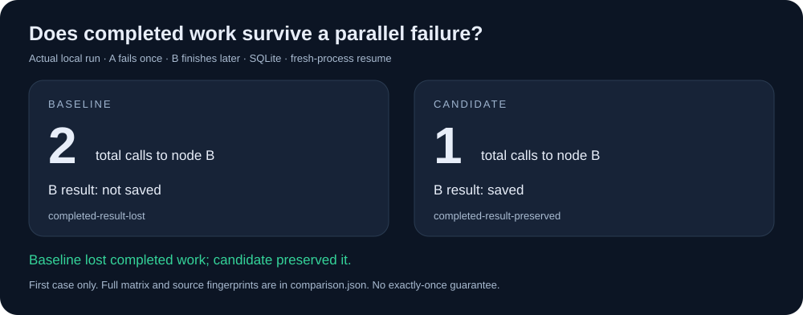

# LangGraph Recovery Lab

**See whether completed work survives a parallel failure.**

[](https://github.com/111111tjb-cell/langgraph-recovery-lab/actions/workflows/check.yml)

**[Open the interactive demo](https://111111tjb-cell.github.io/langgraph-recovery-lab/)** · [中文说明](docs/README.zh-CN.md) · [Measured default report](docs/results/default/comparison.md) · [Full Windows matrix](docs/results/matrix/comparison.md)

Replay the actual recorded events in your browser, with no installation. Use the commands below to execute a new experiment on your machine.



Run a controlled failure, restart Python, and inspect which nodes execute again. The lab compares a pinned upstream LangGraph release with an experimental recovery fix using SQLite. No LLM, model download, API key or external database is needed for the experiment.

This independent lab is maintained by [111111tjb-cell](https://github.com/111111tjb-cell). LangGraph is maintained by LangChain and its contributors. The candidate is an experimental fork, not an official release or a merged upstream fix.

In the recorded Windows / Python 3.12.4 default run, both environments reached the same final state, but the baseline called B twice and the candidate called B once. The complete matrix includes 27 baseline and 27 candidate cases; the baseline lost completed work in 6 exit-mode cases, while all 27 candidate recovery checks passed. These counts belong to this lab, separate from the fork's original 52 regression tests.

## Quick start

Use Python 3.12 or newer:

```sh
git clone https://github.com/111111tjb-cell/langgraph-recovery-lab.git
cd langgraph-recovery-lab
python -m recovery_lab prepare
python -m recovery_lab compare
```

Preparation downloads Python packages and creates two isolated `.venvs` environments. The experiment itself runs locally. Open the printed `index.html` path to explore the saved events, or read `comparison.md` and `comparison.json` beside it.

For the full execution/durability matrix, including cancelled-work controls:

```sh
python -m recovery_lab compare --matrix --include-cancelled --repeat 3
```

## What is being checked?

Two nodes run in parallel. A (`flaky`) intentionally fails on its first attempt. B (`slow`) completes later. A new process then resumes the graph against the same SQLite checkpoint database.

- If B already completed, its result should be saved and B should have one total call.
- If an async B was cancelled without a result, running it again is expected.
- A should have two total calls, and the final state should be `{"a": 1, "b": 1}`.

The upstream report is [langchain-ai/langgraph#9397](https://github.com/langchain-ai/langgraph/issues/9397). The lab records actual outcomes: if the baseline does not reproduce the issue, it says so instead of claiming an improvement.

## Reproducibility

- Baseline: `langgraph==1.2.17`.
- Candidate source: `111111tjb-cell/langgraph` at `e3263b3742852d4e1576baa60d9307aa0e03f8df`.
- Shared direct dependencies are pinned in `requirements/shared.txt`; observed transitive runtime versions are constrained in `requirements/validated-constraints.txt`. This is not a cross-platform hash lock.
- Each report includes loaded package versions and SHA-256 fingerprints of both relevant source files, normalized to LF.
- Both phases run in fresh Python processes. Call counts are persisted separately from the graph checkpoint.
- Output directories must be new or empty. Existing results are not overwritten.

The [online demo](https://111111tjb-cell.github.io/langgraph-recovery-lab/) replays the checked-in default report; its full matrix link opens all recorded cases. The [HTML default report](docs/results/default/index.html) is also self-contained: download it and open it locally for offline use. GitHub's source viewer does not execute its JavaScript. The [actual terminal recording](docs/assets/demo.cast) uses asciinema v2 format. Local project paths in that recording are abbreviated.

## Existing environments

```sh
python -m recovery_lab compare --baseline-python /path/to/baseline/python --candidate-python /path/to/candidate/python
python -m recovery_lab run --python /path/to/python --mode async --durability exit
```

On Windows, use the corresponding `Scripts/python.exe` paths. `run` observes one environment; `compare` checks both. Options include `--delay-ms`, `--timeout`, `--output`, `--repeat` and `--matrix`. See `python -m recovery_lab compare --help`.

## Limits

This is a controlled recovery experiment, not a benchmark. Its delay is fault scheduling, not model latency. Saving graph state does not make external side effects exactly once. A process killed before persistence can still lose work. Results apply to the recorded versions, platform and scenarios; they do not establish behavior for every backend or later release.

The lab makes no model/API calls and disables LangChain/LangSmith tracing in child processes. Package installation requires network access. Local diagnostic logs can contain absolute file paths; review logs before sharing them.

## Development

The command-line driver and its unit tests use only the Python standard library:

```sh
python -m unittest discover -s tests -v
```

Graph execution dependencies are isolated in the prepared environments. The [first hosted CI run](https://github.com/111111tjb-cell/langgraph-recovery-lab/actions/runs/40259639626) passed formatting and unit checks on Linux, macOS and Windows, plus fresh-process integration tests and recovery matrices on Linux and Windows. See [validation scope](VALIDATION.md) for the exact counts. AI assistance was used in development; verification records describe what was actually exercised.

The public demo is generated from the measured default JSON, without separate hand-written result counts. After changing that evidence, run `python -m scripts.build_demo`. CI runs `python -m scripts.build_demo --check` to detect stale published HTML. GitHub Pages serves the `docs/` directory.

## Attribution

The minimal failure scenario builds on the public reproduction in issue #9397 and the [fork's process-restart demonstration](https://github.com/111111tjb-cell/langgraph/blob/e3263b3742852d4e1576baa60d9307aa0e03f8df/examples/reproduce_late_writes.py). LangGraph and adapted scenario code retain their MIT attribution. See [LICENSE](LICENSE) and [THIRD_PARTY_NOTICES.md](THIRD_PARTY_NOTICES.md).
